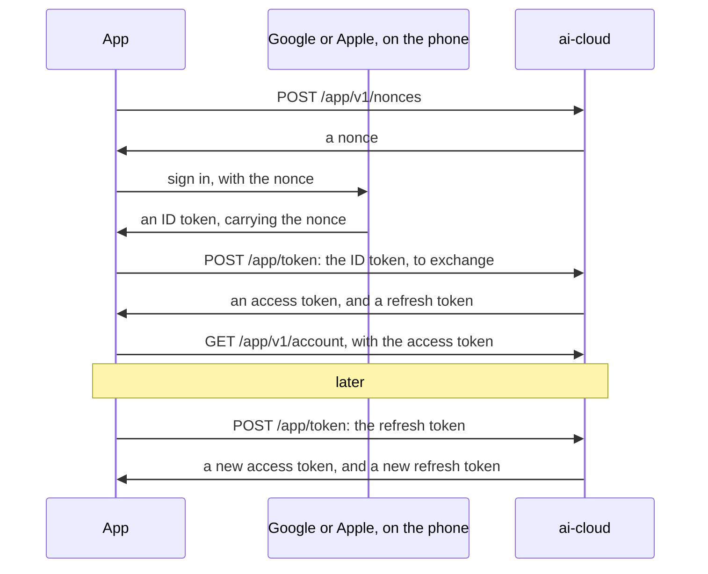

# App API — ai-app ⇄ ai-cloud

How the owner's app talks to `ai-cloud`: signing in, the account and its sessions. Homes, their members and devices, and set-up's registration come in later minor versions.

Version **1.0**:
- It builds on:
  - [ADR-0008](../../docs/decisions/0008-sign-in.md): the cloud's own accounts, reached with Google or Apple, and sessions of its own tokens;
  - [ADR-0005](../../docs/decisions/0005-homes.md): homes, and the people who are their members;
  - [ADR-0003](../../docs/decisions/0003-compatibility.md) and [ADR-0004](../../docs/decisions/0004-conventions.md): compatibility and conventions.
- It meets the [requirements](../cloud/requirements.md) that apply to the app and the cloud, whose identifiers (SEC-6, PRIV-4…) it cites.
- [`schema.json`](schema.json) defines every request and response body, in JSON Schema 2020-12, and [`examples/`](examples/) holds whole exchanges.

**Version notes:**
- **1.0** signs people in, and lets them see and change their account, its identities and its sessions, and delete it.

> **Implemented:** not yet, by the app or the cloud.

## The cloud's address

The app's configuration names the cloud, as `https://`; `http://` only to a developer's own machine (SEC-1). The app drops a trailing slash from it, and appends:
- `/app/token` and `/app/revoke`: OAuth 2.0's token and revocation endpoints, without a version, as devices' `/device/token`;
- `/app/v1/…`: the API, whose major version is in its path ([ADR-0004](../../docs/decisions/0004-conventions.md)).

Bodies are JSON (`application/json`), except at the OAuth endpoints, which take form fields (`application/x-www-form-urlencoded`) as OAuth does. The schema and the examples write those fields as a JSON object.

## Signing in



### The nonce

```http
POST /app/v1/nonces HTTP/1.1
Host: cloud.example
```

```json
{"nonce": "2r-tHb7O8xo1FwnwZIpA8aUlvSLV_mOprWQ3d70JXq0", "expires_in": 300}
```

- **What it is:** 32 random bytes, base64url without padding. It is valid for one exchange, or one identity linked, within `expires_in` seconds.
- **The app gives it to the provider as it is:** `setNonce` for Google's Credential Manager, and the request's `nonce` for Sign in with Apple. The provider puts it in its ID token's `nonce` claim.
- **The cloud forgets a nonce** once it is used, or expired (SEC-12).
- **No sign-in is needed to ask for one,** so the cloud limits how many each address gets (SEC-15).

### The exchange

The app gives the provider's ID token to the token endpoint ([RFC 8693](https://www.rfc-editor.org/rfc/rfc8693), Token Exchange):

```http
POST /app/token HTTP/1.1
Host: cloud.example
Content-Type: application/x-www-form-urlencoded

grant_type=urn%3Aietf%3Aparams%3Aoauth%3Agrant-type%3Atoken-exchange
&subject_token=eyJhbGciOiJSUzI1NiIsImtpZCI6...
&subject_token_type=urn%3Aietf%3Aparams%3Aoauth%3Atoken-type%3Aid_token
&client_id=ai-app
&session_label=Pixel%208
```

| Field | Content |
|---|---|
| `grant_type`, `subject_token_type` | As above |
| `subject_token` | The provider's ID token, as the provider gave it |
| `client_id` | The app's identifier, from its configuration (OAuth 2.0, for a public client) |
| `session_label` | Optional. What the person will see in the list of their sessions, such as the phone's model. Up to 100 characters. |
| `authorization_code` | With Apple's ID token only: the authorization code that Sign in with Apple gave with it. |

**The cloud verifies the ID token itself** ([ADR-0008](../../docs/decisions/0008-sign-in.md), decision 2), and never trusts the app's reading of it:

1. **Its issuer** is a provider the cloud's configuration lists, and **its signature** verifies with that provider's published keys.

   | Provider | `iss` | `aud` |
   |---|---|---|
   | Google | `https://accounts.google.com` (or `accounts.google.com`) | One of the project's Google client IDs |
   | Apple | `https://appleid.apple.com` | The app's bundle identifier |

2. **Its audience** is one of the project's client identifiers, and **it has not expired.**
3. **Its `nonce`** is one the cloud issued, unexpired and unused, which it then forgets.
4. **Its `sub`** names the identity. An identity linked to an account signs in to that account. An identity linked to none creates an account, with the name and email the token gives ([ADR-0008](../../docs/decisions/0008-sign-in.md), decision 1). Accounts are never matched by email.
5. **With Apple's,** the cloud exchanges `authorization_code` with Apple for Apple's refresh token. It keeps that token, encrypted, for the identity, so that it can revoke it when the identity is removed or the account deleted, as Apple asks. A code Apple refuses fails the exchange.

The cloud answers as RFC 8693 does ([`schema.json`](schema.json), `$defs/token_response`):

```json
{"access_token": "Bq2lMIy1Dm5i3UuDFQ7iJw...", "issued_token_type": "urn:ietf:params:oauth:token-type:access_token",
 "token_type": "Bearer", "expires_in": 600, "refresh_token": "rT1n9v0wq8cT2zrQyD6qG8..."}
```

- **The access token** goes with every request to `/app/v1/…`, as `Authorization: Bearer` ([RFC 6750](https://www.rfc-editor.org/rfc/rfc6750)). It is opaque to the app.
- **The refresh token** starts a session: one app, on one phone. The app keeps it in the phone's secure storage, the Keystore or the Keychain, and nowhere else.

### Refreshing

Before its access token expires, or when a request is refused with `401`, the app refreshes:

```http
POST /app/token HTTP/1.1
Host: cloud.example
Content-Type: application/x-www-form-urlencoded

grant_type=refresh_token&refresh_token=rT1n9v0wq8cT2zrQyD6qG8...&client_id=ai-app
```

- **The answer is the same as the exchange's,** with a new refresh token. The app replaces the old one at once.
- **Rotation:** a refresh token works once ([RFC 9700](https://www.rfc-editor.org/rfc/rfc9700), §4.14.2). One presented again was stolen or replayed: the cloud refuses it with `invalid_grant`, and ends its session, so that neither copy works.
- **A session left unused** for `refresh_idle` ends.
- **After `invalid_grant`,** the app signs in again.

### Signing out

```http
POST /app/revoke HTTP/1.1
Host: cloud.example
Content-Type: application/x-www-form-urlencoded

token=rT1n9v0wq8cT2zrQyD6qG8...&token_type_hint=refresh_token&client_id=ai-app
```

The cloud ends the session, and answers `200` whatever the token was ([RFC 7009](https://www.rfc-editor.org/rfc/rfc7009)). The app deletes its tokens either way.

### Requests

- **Every request to `/app/v1/…` carries the access token,** except asking for a nonce, and the development endpoint.
- **A missing, expired or revoked token** gets `401`, with `WWW-Authenticate: Bearer error="invalid_token"` (RFC 6750).
- **The cloud confines every request** to the account the token names, and to that account's homes (SEC-6).

## The account

### Reading it

`GET /app/v1/account`:

```json
{"id": "01a190f9-0000-7a1c-9b2e-4d7f6a1b2c3d", "display_name": "Linh", "email": "linh@example.com",
 "languages": ["vi", "en"], "create_time": "2026-10-31T08:00:00Z", "etag": "W/\"2\"",
 "identities": [{"id": "01a190f9-000a-7b2d-8c3f-5e8a7b2c3d4e", "provider": "google",
                 "email": "linh@example.com", "create_time": "2026-10-31T08:00:00Z"}]}
```

- **`display_name` and `email`** start as the provider gave them. An email may be missing: Apple gives one at the first sign-in only, and may give a relay.
- **`languages`** are the person's, most preferred first ([ADR-0002](../../docs/decisions/0002-languages.md)). They start empty: the app sets them.
- **`identities`** are the ways to sign in. The account outlives any one of them.

### Changing it

`PATCH /app/v1/account`, with the fields to change: `display_name`, `languages`, or both. The cloud answers with the account.

- **`If-Match`,** with the account's `etag`, makes the change only if nobody changed the account since ([ADR-0004](../../docs/decisions/0004-conventions.md)). Otherwise the cloud answers `412`.
- **`display_name`** is 1 to 100 characters, and **`languages`** 0 to 10 BCP 47 tags.

### Deleting it

Deleting is for good, and a phone left unlocked must not be enough for it. So the person signs in again first: the app gets a nonce, and an ID token of one of the account's identities, as for signing in.

`POST /app/v1/account:delete`, with `{"id_token": "…"}`, deletes the account and everything that is the person's ([ADR-0005](../../docs/decisions/0005-homes.md), PRIV-4). It then answers `204`.

- **The ID token** must verify as for the exchange, name one of the account's identities, and be at most `recent_sign_in` old. Otherwise the cloud answers `403` `recent_sign_in_required`. With Apple's, `authorization_code` comes too.
- **It ends every session,** and revokes Apple's tokens with the refresh tokens the cloud keeps.
- **The owner of a home with other members** gets `409` `owns_home_with_members`, until they hand the home over or delete it.
- **The cloud serves a page on the web** to request the same, as Google Play requires ([ADR-0008](../../docs/decisions/0008-sign-in.md), decision 4). The page is not part of this API.

### Identities

- **Linking another provider:** the app gets a nonce and an ID token as for signing in, then `POST /app/v1/account/identities` with `{"id_token": "…"}`, and `authorization_code` with Apple's. The cloud verifies the token as for the exchange, and answers `201` with the new identity.
  - An identity already linked to another account gets `409` `identity_taken`.
  - One already linked to this account gets `409` `identity_linked`.
- **Removing one:** `DELETE /app/v1/account/identities/{id}`, which answers `204`. Removing Apple's revokes its tokens. The last identity gets `409` `last_identity`: the person deletes the account instead.

### Sessions

`GET /app/v1/account/sessions` lists the account's sessions, in pages ([ADR-0004](../../docs/decisions/0004-conventions.md)):

```json
{"sessions": [{"id": "01a190f9-0014-7c3e-ad4a-6f9b8c3d4e5f", "label": "Pixel 8",
               "create_time": "2026-10-31T08:00:00Z", "last_use_time": "2026-10-31T09:12:00Z",
               "current": true}],
 "next_page_token": ""}
```

- **Paging:** `page_size`, from 1 to 50, 20 when absent; `page_token`, from the previous page. An empty `next_page_token` means there are no more.
- **`current`** marks the session of the token that asks.
- **Ending a session:** `DELETE /app/v1/account/sessions/{id}`, which answers `204`. Its refresh token stops working, and its access tokens expire within `access_lifetime`.

## Errors

- **The OAuth endpoints** answer as OAuth does ([RFC 6749](https://www.rfc-editor.org/rfc/rfc6749), §5.2): `400` or `401`, with `error` and `error_description`.

  | `error` | Meaning |
  |---|---|
  | `invalid_request` | A field is missing, repeated or malformed |
  | `invalid_client` | `client_id` is not the app's |
  | `invalid_grant` | The ID token, its nonce or the refresh token failed. The app signs in again. |
  | `unsupported_grant_type` | A grant this version does not have |

- **The API** answers with Problem Details ([RFC 9457](https://www.rfc-editor.org/rfc/rfc9457)).
  - A problem the app acts on has a `type` of its own: `/app/v1/problems/` followed by its code. The app compares `type` as written.
  - Any other problem is `about:blank`, and its status says it all.

  ```json
  {"type": "/app/v1/problems/last_identity", "title": "Last identity", "status": 409,
   "detail": "This is the account's only way to sign in."}
  ```

  | Code | Status | Meaning |
  |---|---|---|
  | `owns_home_with_members` | 409 | The account owns a home with other members |
  | `identity_taken` | 409 | The identity belongs to another account |
  | `identity_linked` | 409 | The identity is already this account's |
  | `last_identity` | 409 | The identity is the account's last |
  | `recent_sign_in_required` | 403 | Deleting the account needs a fresh sign-in with one of its identities |

- **Limits:** a request over a limit gets `429`, with `Retry-After`.
- **Text:** `detail` and `error_description` are for logs, in English. The app shows people texts of its own catalogs, chosen by status and type.

## Development

The cloud's development environment signs in test people without Google or Apple ([ADR-0008](../../docs/decisions/0008-sign-in.md), decision 5):

`POST /app/v1/development/id-tokens`, with `{"nonce": "…", "display_name": "Test", "email": "test@example.com"}`, answers `{"id_token": "…"}`.

- **The token** is made as a provider's is: signed by a key of the development cloud, with an issuer of its own, the app's `client_id` as its audience, the nonce, and a `sub` that the email decides.
- **The app exchanges it** as any ID token, so that sign-in runs the same path end to end.
- **Production** has no such endpoint, which answers `404`, and refuses that issuer.

## Security and privacy

How this version meets the [requirements](../cloud/requirements.md#9-security):
- **SEC-1:** TLS to the cloud. Plain HTTP only to a developer's own machine.
- **SEC-6:** every request is confined to the account its token names, and to that account's homes.
- **SEC-12:**
  - nonces are single-use and expire;
  - access tokens expire within `access_lifetime`;
  - refresh tokens rotate, and one presented twice ends its session.
- **SEC-14, SEC-15:** the cloud validates every body against `schema.json`, and limits rates, the nonces' above all.
- **PRIV-4:** the person deletes the account, and with it everything that is theirs, from the app or the web. A fresh sign-in comes first, so that a phone left unlocked cannot do it.
- **PRIV-7:** accounts are for adults. The cloud keeps no birth date and has no child accounts.
- **Tokens are never logged.** Neither side logs an ID token, an access token, a refresh token, an authorization code or a nonce. The cloud keeps Apple's refresh tokens encrypted.

## Settings

The values below are starting points, not part of the protocol: the cloud sets its own in its configuration.

| Setting | Starting point | Meaning |
|---|---|---|
| `nonce_lifetime` | 300 s | How long a nonce is valid |
| `access_lifetime` | 600 s | How long an access token is valid |
| `refresh_idle` | 90 days | How long a session lasts unused |
| `recent_sign_in` | 300 s | How old an ID token may be, to delete the account |
| `nonce_rate` | 10 a minute, for each address | How many nonces an address gets |

## Changing the protocol

- **Minor version.** A new endpoint, or a new optional field, raises the minor version. The specification, the schema and the examples change together (CONTRIBUTING.md, rule 2).
- **Major version.** Changing or removing anything the app relies on raises the major version, with a path of its own (`/app/v2/`). The cloud serves both majors side by side ([ADR-0003](../../docs/decisions/0003-compatibility.md)).

## References

- IETF: [RFC 6749](https://www.rfc-editor.org/rfc/rfc6749) (OAuth 2.0), [RFC 6750](https://www.rfc-editor.org/rfc/rfc6750) (bearer tokens), [RFC 7009](https://www.rfc-editor.org/rfc/rfc7009) (revocation), [RFC 8693](https://www.rfc-editor.org/rfc/rfc8693) (token exchange), [RFC 9700](https://www.rfc-editor.org/rfc/rfc9700) (OAuth 2.0 security), [RFC 9457](https://www.rfc-editor.org/rfc/rfc9457) (Problem Details), [RFC 9110](https://www.rfc-editor.org/rfc/rfc9110) (HTTP semantics), [RFC 9562](https://www.rfc-editor.org/rfc/rfc9562) (UUIDv7), [RFC 3339](https://www.rfc-editor.org/rfc/rfc3339).
- [OpenID Connect Core 1.0](https://openid.net/specs/openid-connect-core-1_0.html): ID tokens and their nonce.
- Google: [Sign in with Google with Credential Manager](https://developer.android.com/identity/sign-in/credential-manager-siwg-implementation). Apple: [Sign in with Apple](https://developer.apple.com/documentation/sign_in_with_apple).
- Google's [API Improvement Proposals](https://google.aip.dev/): resources, paging (AIP-158), updates and ETags (AIP-134, AIP-154).
