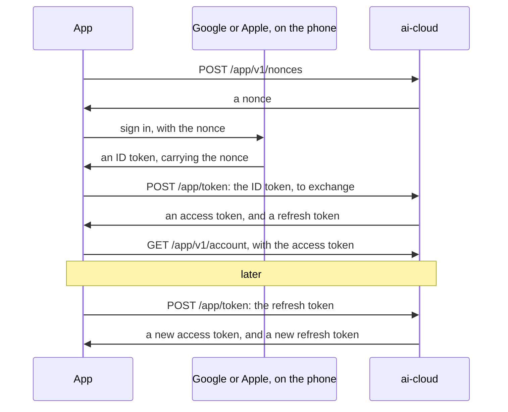

# App API — ai-app ⇄ ai-cloud

How the owner's app talks to `ai-cloud`: signing in, the account and its sessions, and homes and the people in them. A home's devices and set-up's registration come in later minor versions.

Version **1.3**:
- It builds on:
  - [ADR-0008](../../docs/decisions/0008-sign-in.md): the cloud's own accounts, reached with Google or Apple, and sessions of its own tokens, which [ADR-0011](../../docs/decisions/0011-refreshing-again.md) lets an app refresh again after a lost answer;
  - [ADR-0005](../../docs/decisions/0005-homes.md) and [ADR-0009](../../docs/decisions/0009-people-in-a-home.md): homes, the people who are their members, what each may do, and how they join;
  - [ADR-0003](../../docs/decisions/0003-compatibility.md) and [ADR-0004](../../docs/decisions/0004-conventions.md): compatibility and conventions;
  - [ADR-0010](../../docs/decisions/0010-patterns.md): patterns that every engine reads alike.
- It meets the [requirements](../cloud/requirements.md) that apply to the app and the cloud, whose identifiers (SEC-6, PRIV-4…) it cites.
- [`schema.json`](schema.json) defines every request and response body, in JSON Schema 2020-12, and [`examples/`](examples/) holds whole exchanges.

**Version notes:**
- **1.3** lets a refresh token refresh again just after its first use, while the token that replaced it is unused, so that an answer lost on the way does not end the session ([ADR-0011](../../docs/decisions/0011-refreshing-again.md)). An app of 1.2 never presents a token again, so nothing breaks.
- **1.2** writes the email's and the name's patterns so that every engine reads them alike ([ADR-0010](../../docs/decisions/0010-patterns.md)). The email's now refuses control characters too. No app exists yet, and the cloud keeps only the emails that providers have verified, so nothing breaks.
- **1.1** adds homes: creating and changing them, the people in them and their roles, profiles, invitations, handing a home over, and deleting it. It also says what a refused ID token gets when it links an identity, what a name may hold, and what "other members" means when an account is deleted.
- **1.0** signs people in, and lets them see and change their account, its identities and its sessions, and delete it.

> **Implemented:** version 1.2 by the cloud, but for Apple and the page at `/join`. The app: not yet.

## The cloud's address

The app's configuration names the cloud, as `https://`; `http://` only to a developer's own machine (SEC-1). The app drops a trailing slash from it, and appends:
- `/app/token` and `/app/revoke`: OAuth 2.0's token and revocation endpoints, without a version, as devices' `/device/token`;
- `/app/v1/…`: the API, whose major version is in its path ([ADR-0004](../../docs/decisions/0004-conventions.md));
- `/join`: the page that an invitation's link opens ([Invitations](#invitations)).

Bodies are JSON (`application/json`), except at the OAuth endpoints, which take form fields (`application/x-www-form-urlencoded`) as OAuth does. The schema and the examples write those fields as a JSON object.

## Signing in



### The nonce

```http
POST /app/v1/nonces HTTP/1.1
Host: cloud.example
```

```json
{"nonce": "2r-tHb7O8xo1FwnwZIpA8aUlvSLV_mOprWQ3d70JXq0", "expires_in": 300}
```

- **What it is:** 32 random bytes, base64url without padding. It is valid for one exchange, or one identity linked, within `expires_in` seconds.
- **The app gives it to the provider as it is:** `setNonce` for Google's Credential Manager, and the request's `nonce` for Sign in with Apple. The provider puts it in its ID token's `nonce` claim.
- **The cloud forgets a nonce** once it is used, or expired (SEC-12).
- **No sign-in is needed to ask for one,** so the cloud limits how many each address gets (SEC-15).

### The exchange

The app gives the provider's ID token to the token endpoint ([RFC 8693](https://www.rfc-editor.org/rfc/rfc8693), Token Exchange):

```http
POST /app/token HTTP/1.1
Host: cloud.example
Content-Type: application/x-www-form-urlencoded

grant_type=urn%3Aietf%3Aparams%3Aoauth%3Agrant-type%3Atoken-exchange
&subject_token=eyJhbGciOiJSUzI1NiIsImtpZCI6...
&subject_token_type=urn%3Aietf%3Aparams%3Aoauth%3Atoken-type%3Aid_token
&client_id=ai-app
&session_label=Pixel%208
```

| Field | Content |
|---|---|
| `grant_type`, `subject_token_type` | As above |
| `subject_token` | The provider's ID token, as the provider gave it |
| `client_id` | The app's identifier, from its configuration (OAuth 2.0, for a public client) |
| `session_label` | Optional. What the person will see in the list of their sessions, such as the phone's model. Up to 100 characters. |
| `authorization_code` | With Apple's ID token only: the authorization code that Sign in with Apple gave with it. |

**The cloud verifies the ID token itself** ([ADR-0008](../../docs/decisions/0008-sign-in.md), decision 2), and never trusts the app's reading of it:

1. **Its issuer** is a provider the cloud's configuration lists, and **its signature** verifies with that provider's published keys.

   | Provider | `iss` | `aud` |
   |---|---|---|
   | Google | `https://accounts.google.com` (or `accounts.google.com`) | One of the project's Google client IDs |
   | Apple | `https://appleid.apple.com` | The app's bundle identifier |

2. **Its audience** is one of the project's client identifiers, and **it has not expired.**
3. **Its `nonce`** is one the cloud issued, unexpired and unused, which it then forgets.
4. **Its `sub`** names the identity. An identity linked to an account signs in to that account. An identity linked to none creates an account, with the name and email the token gives ([ADR-0008](../../docs/decisions/0008-sign-in.md), decision 1). Accounts are never matched by email.
5. **With Apple's,** the cloud exchanges `authorization_code` with Apple for Apple's refresh token. It keeps that token, encrypted, for the identity, so that it can revoke it when the identity is removed or the account deleted, as Apple asks. A code Apple refuses fails the exchange.

The cloud answers as RFC 8693 does ([`schema.json`](schema.json), `$defs/token_response`):

```json
{"access_token": "Bq2lMIy1Dm5i3UuDFQ7iJw...", "issued_token_type": "urn:ietf:params:oauth:token-type:access_token",
 "token_type": "Bearer", "expires_in": 600, "refresh_token": "rT1n9v0wq8cT2zrQyD6qG8..."}
```

- **The access token** goes with every request to `/app/v1/…`, as `Authorization: Bearer` ([RFC 6750](https://www.rfc-editor.org/rfc/rfc6750)). It is opaque to the app.
- **The refresh token** starts a session: one app, on one phone. The app keeps it in the phone's secure storage, the Keystore or the Keychain, and nowhere else.

### Refreshing

Before its access token expires, or when a request is refused with `401`, the app refreshes:

```http
POST /app/token HTTP/1.1
Host: cloud.example
Content-Type: application/x-www-form-urlencoded

grant_type=refresh_token&refresh_token=rT1n9v0wq8cT2zrQyD6qG8...&client_id=ai-app
```

- **The answer is the same as the exchange's,** with a new refresh token. The app replaces the old one at once.
- **Rotation:** a refresh token works once ([RFC 9700](https://www.rfc-editor.org/rfc/rfc9700), §4.14.2), but for a retry ([ADR-0011](../../docs/decisions/0011-refreshing-again.md)).
  - **A retry:** for `refresh_reuse` after its first use, while the token that replaced it has not been used, a refresh token refreshes again. The cloud answers with new tokens, and the ones it gave before stop working.
  - **The app sends a refresh again** only when no answer came, at once, with the same refresh token.
  - **Any other token presented again** was stolen or replayed: the cloud refuses it with `invalid_grant`, and ends its session, so that no copy works.
- **A session left unused** for `refresh_idle` ends.
- **After `invalid_grant`,** the app signs in again.

### Signing out

```http
POST /app/revoke HTTP/1.1
Host: cloud.example
Content-Type: application/x-www-form-urlencoded

token=rT1n9v0wq8cT2zrQyD6qG8...&token_type_hint=refresh_token&client_id=ai-app
```

The cloud ends the session, and answers `200` whatever the token was ([RFC 7009](https://www.rfc-editor.org/rfc/rfc7009)). The app deletes its tokens either way.

### Requests

- **Every request to `/app/v1/…` carries the access token,** except asking for a nonce, and the development endpoint.
- **A missing, expired or revoked token** gets `401`, with `WWW-Authenticate: Bearer error="invalid_token"` (RFC 6750).
- **The cloud confines every request** to the account the token names, and to that account's homes (SEC-6).
- **`Idempotency-Key`** ([ADR-0004](../../docs/decisions/0004-conventions.md)) goes on the requests this specification names, so that a retry does not create a thing twice. Its value is a UUID that the app makes, as a quoted string: `Idempotency-Key: "01a1a06c-1400-75e6-a77f-f2149dbe59d5"`.
  - **A retry** with the same key and body gets the first answer, for `idempotency_retention`. Each account's keys are its own.
  - **No key** gets `400`, **a key used with another body** gets `422`, and **a retry while the first request still runs** gets `409`, which the app tries again ([the IETF's draft](https://datatracker.ietf.org/doc/draft-ietf-httpapi-idempotency-key-header/), version 08). All three are `about:blank`.

## The account

### Reading it

`GET /app/v1/account`:

```json
{"id": "01a190f9-0000-7a1c-9b2e-4d7f6a1b2c3d", "display_name": "Linh", "email": "linh@example.com",
 "languages": ["vi", "en"], "create_time": "2026-10-31T08:00:00Z", "etag": "W/\"2\"",
 "identities": [{"id": "01a190f9-000a-7b2d-8c3f-5e8a7b2c3d4e", "provider": "google",
                 "email": "linh@example.com", "create_time": "2026-10-31T08:00:00Z"}]}
```

- **`display_name` and `email`** start as the provider gave them. An email may be missing: Apple gives one at the first sign-in only, and may give a relay.
- **`languages`** are the person's, most preferred first ([ADR-0002](../../docs/decisions/0002-languages.md)). They start empty: the app sets them.
- **`identities`** are the ways to sign in. The account outlives any one of them.

### Changing it

`PATCH /app/v1/account`, with the fields to change: `display_name`, `languages`, or both. The cloud answers with the account.

- **`If-Match`,** with the account's `etag`, makes the change only if nobody changed the account since ([ADR-0004](../../docs/decisions/0004-conventions.md)). Otherwise the cloud answers `412`.
- **`display_name`** is 1 to 100 characters, and **`languages`** 0 to 10 BCP 47 tags. A name with control characters gets `400`.

### Deleting it

Deleting is for good, and a phone left unlocked must not be enough for it. So the person signs in again first: the app gets a nonce, and an ID token of one of the account's identities, as for signing in.

`POST /app/v1/account:delete`, with `{"id_token": "…"}`, deletes the account and everything that is the person's ([ADR-0005](../../docs/decisions/0005-homes.md), PRIV-4). It then answers `204`.

- **The ID token** must verify as for the exchange, name one of the account's identities, and be at most `recent_sign_in` old. Otherwise the cloud answers `403` `recent_sign_in_required`. With Apple's, `authorization_code` comes too.
- **It ends every session,** and revokes Apple's tokens with the refresh tokens the cloud keeps.
- **The owner of a home with other members** gets `409` `owns_home_with_members`, until they hand the home over or delete it. Other members means other people with accounts: a home whose other people are all profiles goes with the account, since a profile cannot take a home over ([ADR-0009](../../docs/decisions/0009-people-in-a-home.md), decision 7).
- **In a home the account does not own,** its person is removed, as if they had left.
- **The cloud serves a page on the web** to request the same, as Google Play requires ([ADR-0008](../../docs/decisions/0008-sign-in.md), decision 4). The page is not part of this API.

### Identities

- **Linking another provider:** the app gets a nonce and an ID token as for signing in, then `POST /app/v1/account/identities` with `{"id_token": "…"}`, and `authorization_code` with Apple's. The cloud verifies the token as for the exchange, and answers `201` with the new identity.
  - An identity already linked to another account gets `409` `identity_taken`.
  - One already linked to this account gets `409` `identity_linked`.
  - An ID token that fails gets `403`.
- **Removing one:** `DELETE /app/v1/account/identities/{id}`, which answers `204`. Removing Apple's revokes its tokens. The last identity gets `409` `last_identity`: the person deletes the account instead.

### Sessions

`GET /app/v1/account/sessions` lists the account's sessions, in pages ([ADR-0004](../../docs/decisions/0004-conventions.md)):

```json
{"sessions": [{"id": "01a190f9-0014-7c3e-ad4a-6f9b8c3d4e5f", "label": "Pixel 8",
               "create_time": "2026-10-31T08:00:00Z", "last_use_time": "2026-10-31T09:12:00Z",
               "current": true}],
 "next_page_token": ""}
```

- **Paging:** `page_size`, from 1 to 50, 20 when absent; `page_token`, from the previous page. An empty `next_page_token` means there are no more.
- **`current`** marks the session of the token that asks.
- **Ending a session:** `DELETE /app/v1/account/sessions/{id}`, which answers `204`. Its refresh token stops working, and its access tokens expire within `access_lifetime`.

## Homes

A home owns devices, and people are its members ([ADR-0005](../../docs/decisions/0005-homes.md), [ADR-0009](../../docs/decisions/0009-people-in-a-home.md)).

### What each role may do

| | Owner | Admin | Member |
|---|---|---|---|
| See the home and who is in it | ✓ | ✓ | ✓ |
| Change the home's name, time zone and languages | ✓ | ✓ | |
| Invite people, and add profiles | ✓ | ✓ | |
| Rename or remove members and profiles | ✓ | ✓ | |
| Rename or remove an admin, and change a person's role | ✓ | | |
| Hand the home over, and delete it | ✓ | | |
| Rename themself | ✓ | ✓ | ✓ |
| Leave the home | | ✓ | ✓ |

- **A home the account is not in** answers `404`, as if it did not exist, and so does anything in it (SEC-6). So does an identifier that the home does not hold.
- **A role that does not allow a request** gets `403` `role_required`.
- **A role the app does not know,** from a later version, counts as `member`, and **a kind it does not know** as `profile`. The app offers nothing more for them.

### Creating a home

`POST /app/v1/homes`, with an `Idempotency-Key`:

```json
{"name": "Nhà Linh", "time_zone": "Asia/Ho_Chi_Minh", "languages": ["vi", "en"]}
```

The cloud answers `201`, with the home. The person who asks is its owner.

```json
{"id": "01a1a06c-1400-7ffd-b448-26955bb4d510", "name": "Nhà Linh", "time_zone": "Asia/Ho_Chi_Minh",
 "languages": ["vi", "en"], "member_id": "01a1a06c-1400-7375-973f-8d9c68138cc8", "role": "owner",
 "create_time": "2026-11-03T08:00:00Z", "etag": "W/\"1\""}
```

- **Nobody gets a home by signing in.** For an account with none, the app offers to create one, with the phone's time zone and languages to start from.
- **`member_id` and `role`** are those of the person who asks.
- **`name`** is 1 to 100 characters, without control characters.
- **`time_zone`** is an IANA name. The cloud answers `400` to one it does not know.
- **`languages`** are 1 to 10 BCP 47 tags, most preferred first: what the home's devices speak, until their own settings say otherwise ([ADR-0002](../../docs/decisions/0002-languages.md)).
- **An account already in `homes_per_account` homes** gets `409` `home_limit_reached`.

### Reading and changing a home

- **Listing:** `GET /app/v1/homes` lists the homes the account is in, in pages, as sessions are: `{"homes": […], "next_page_token": ""}`.
- **Reading one:** `GET /app/v1/homes/{home_id}`.
- **Changing it:** `PATCH /app/v1/homes/{home_id}`, for the owner and admins, with the fields to change: `name`, `time_zone`, `languages`. The cloud answers with the home. `If-Match` works as for the account.

### The people in a home

`GET /app/v1/homes/{home_id}/members` lists them, in pages, for anyone in the home:

```json
{"members": [{"id": "01a1a06c-1400-7375-973f-8d9c68138cc8", "kind": "account", "display_name": "Linh", "role": "owner",
              "current": true, "create_time": "2026-11-03T08:00:00Z", "etag": "W/\"1\""},
             {"id": "01a1a070-a7e0-7f57-8a14-d9e82cf62633", "kind": "profile", "display_name": "Bà",
              "current": false, "create_time": "2026-11-03T08:05:00Z", "etag": "W/\"1\""}],
 "next_page_token": ""}
```

- **`id`** names this person in this home. What the cloud keeps of a person refers to it.
- **`kind`** is `account`, for a person who signs in, or `profile`, for one who never does.
- **`role`** is `owner`, `admin` or `member`. A profile has none.
- **`display_name`** is this home's name for the person. It starts as their account's name, and does not follow it afterwards.
- **`current`** marks the person who asks.
- **Nothing else about a person is shown:** no email, and nothing that ties them to their other homes.

**Adding a profile:** `POST /app/v1/homes/{home_id}/members`, for the owner and admins, with an `Idempotency-Key` and `{"display_name": "Bà"}`, answers `201` with the member. People with accounts come by invitation. A home with `members_per_home` people gets `409` `member_limit_reached`.

**Changing a person:** `PATCH /app/v1/homes/{home_id}/members/{member_id}`, with `If-Match` as for the account, answers with the member.
- **`display_name`,** 1 to 100 characters without control characters, is for the owner to change on anyone, for an admin on members and profiles, and for anyone on themself.
- **`role`,** `admin` or `member`, is for the owner to change, on another person with an account. Only handing the home over makes an owner. A role on a profile, or on the owner, gets `409`. Demoting an admin revokes the invitations they made.

**Removing a person:** `DELETE /app/v1/homes/{home_id}/members/{member_id}`, which answers `204`.
- **The owner** removes anyone else, and **an admin** removes members and profiles.
- **Anyone may remove themself:** that is leaving. The owner cannot, and gets `409` `owner_cannot_leave`: they hand the home over or delete it.
- **It deletes what belongs to that person in that home** ([ADR-0005](../../docs/decisions/0005-homes.md), decision 4; PRIV-4). What belongs to the home stays, and so do their account and their other homes. The app warns first.
- **It revokes** the invitations that person made.

### Invitations

People with accounts join with a code that works once.

**Making one:** `POST /app/v1/homes/{home_id}/invitations`, for the owner and admins, with no body, answers `201`:

```json
{"id": "01a1a075-3bc0-7f24-afff-ec2f264278ac", "code": "_qkVmTR2PblWSSdl5dzV2U5KeCbtmjs4Pd7HS-vBAx4",
 "invited_by": "Linh", "create_time": "2026-11-03T08:10:00Z", "expire_time": "2026-11-06T08:10:00Z"}
```

- **`code`** is 32 random bytes, base64url without padding. This answer is the only place it appears: the cloud keeps its hash.
- **No `Idempotency-Key`,** since the cloud could not repeat a code it does not keep. A retry makes another invitation, and the first expires unused.
- **A home with `invitations_per_home` open invitations** gets `409` `invitation_limit_reached`.

**Sharing it:** the app shares a link with the code as its fragment, as text or as a QR code: the cloud's address, then `/join#`, then the code.
- **The fragment stays out of every log.** A browser dereferences a link without it ([RFC 3986](https://www.rfc-editor.org/rfc/rfc3986), §3.5), so no server or tunnel sees the code.
- **The cloud serves `/join`:** a page that says how to get the app. It also serves what lets a phone open the app for that path: [Android's App Links](https://developer.android.com/training/app-links) and [Apple's universal links](https://developer.apple.com/documentation/xcode/supporting-associated-domains). The app gets the whole link, fragment included.
- **The app also takes the link** pasted, or from a QR code through its own scanner.

**Seeing and revoking them:**
- `GET /app/v1/homes/{home_id}/invitations`, for the owner and admins, lists the open ones, in pages, without their codes.
- `DELETE /app/v1/homes/{home_id}/invitations/{invitation_id}` revokes one, and answers `204`.

**Joining:** the person signs in first, if they have not. The code goes in the body, never in a URL, so that it stays out of logs.
- **Looking:** `POST /app/v1/invitations:lookup`, with `{"code": "…"}`, answers `200` with what the person sees before they agree:

  ```json
  {"home_name": "Nhà Linh", "invited_by": "Linh", "expire_time": "2026-11-06T08:10:00Z"}
  ```

- **Accepting:** `POST /app/v1/invitations:accept`, with the same body, answers `201` with the home. The person joins as a `member`, with their account's name. Only the owner can raise them later.
- **A person already in the home** gets `200` with the home, and a code not yet used stays unused. A retry after a lost answer thus ends in the same place.
- **A code that is unknown, expired, revoked, or used by someone else** gets `404` `invitation_invalid`. The cloud does not say which.
- **The limits** are `home_limit_reached` and `member_limit_reached`, as above. The cloud also limits how many codes an account tries, with `invitation_rate` (SEC-15).

### Handing a home over

The owner signs in again, as to delete the account. `POST /app/v1/homes/{home_id}:transfer`, with `{"to_member_id": "…", "id_token": "…"}`, answers `200` with the home, as the old owner now sees it. The person named is the owner at once, and the old owner an admin, who can then leave ([ADR-0009](../../docs/decisions/0009-people-in-a-home.md), decision 6).

- **`to_member_id`** is another person in the home with an account. Anyone else gets `409`.
- **The ID token** must verify as for deleting the account. Otherwise the cloud answers `403` `recent_sign_in_required`.
- **The app warns the owner first:** the change takes effect at once, and the new owner can then remove them.
- **The new owner can hand the home back** the same way, if they did not want it.

### Deleting a home

Deleting is for good, so the owner signs in again first, as to delete the account. `POST /app/v1/homes/{home_id}:delete`, with `{"id_token": "…"}`, answers `204`.

- **The owner must be the home's last person with an account.** Otherwise the cloud answers `409` `owns_home_with_members`: the others leave, or the owner removes them or hands the home over, first.
- **It deletes** the home, its profiles, its invitations, and everything the cloud keeps there for it and its people ([ADR-0005](../../docs/decisions/0005-homes.md), PRIV-4). The owner's account stays.
- **It revokes its devices' registrations** (SEC-3). A connected device gets `bye` `revoked` on [the cloud link](../cloud/README.md), and every one of them then offers set-up (PROV-3).
- **The ID token** must verify as for deleting the account. Otherwise the cloud answers `403` `recent_sign_in_required`.

## Errors

- **The OAuth endpoints** answer as OAuth does ([RFC 6749](https://www.rfc-editor.org/rfc/rfc6749), §5.2): `400` or `401`, with `error` and `error_description`.

  | `error` | Meaning |
  |---|---|
  | `invalid_request` | A field is missing, repeated or malformed |
  | `invalid_client` | `client_id` is not the app's |
  | `invalid_grant` | The ID token, its nonce or the refresh token failed. The app signs in again. |
  | `unsupported_grant_type` | A grant this version does not have |

- **The API** answers with Problem Details ([RFC 9457](https://www.rfc-editor.org/rfc/rfc9457)).
  - A problem the app acts on has a `type` of its own: `/app/v1/problems/` followed by its code. The app compares `type` as written.
  - Any other problem is `about:blank`, and its status says it all.

  ```json
  {"type": "/app/v1/problems/last_identity", "title": "Last identity", "status": 409,
   "detail": "This is the account's only way to sign in."}
  ```

  | Code | Status | Meaning |
  |---|---|---|
  | `owns_home_with_members` | 409 | The account owns a home with other people with accounts, so it cannot delete itself or that home yet |
  | `identity_taken` | 409 | The identity belongs to another account |
  | `identity_linked` | 409 | The identity is already this account's |
  | `last_identity` | 409 | The identity is the account's last |
  | `recent_sign_in_required` | 403 | Deleting the account or a home, or handing a home over, needs a fresh sign-in with one of the account's identities |
  | `role_required` | 403 | The person's role in the home does not allow this |
  | `owner_cannot_leave` | 409 | The owner leaves only by handing the home over or deleting it |
  | `invitation_invalid` | 404 | The code is unknown, expired, revoked, or used by someone else |
  | `home_limit_reached` | 409 | The account is in as many homes as it may be |
  | `member_limit_reached` | 409 | The home has as many people as it may have |
  | `invitation_limit_reached` | 409 | The home has as many open invitations as it may have |

- **Limits:** a request over a limit gets `429`, with `Retry-After`.
- **Text:** `detail` and `error_description` are for logs, in English. The app shows people texts of its own catalogs, chosen by status and type.

## Development

The cloud's development environment signs in test people without Google or Apple ([ADR-0008](../../docs/decisions/0008-sign-in.md), decision 5):

`POST /app/v1/development/id-tokens`, with `{"nonce": "…", "display_name": "Test", "email": "test@example.com"}`, answers `{"id_token": "…"}`.

- **The token** is made as a provider's is: signed by a key of the development cloud, with an issuer of its own, the app's `client_id` as its audience, the nonce, and a `sub` that the email decides.
- **The app exchanges it** as any ID token, so that sign-in runs the same path end to end.
- **Production** has no such endpoint, which answers `404`, and refuses that issuer.

## Security and privacy

How this version meets the [requirements](../cloud/requirements.md#9-security):
- **SEC-1:** TLS to the cloud. Plain HTTP only to a developer's own machine.
- **SEC-3:** deleting a home revokes its devices' registrations.
- **SEC-6:** every request is confined to the account its token names, and to that account's homes. A home the account is not in answers `404`.
- **SEC-12:**
  - nonces are single-use and expire;
  - access tokens expire within `access_lifetime`;
  - refresh tokens rotate, and one presented again ends its session, but for a retry just after its first use, while its replacement is unused. A retry continues the same session, whose replacement then stops working, so that it never has two refresh tokens that work;
  - an invitation's code works once, expires, and is kept only as a hash. Removing or demoting the person who made it revokes it, so that nobody keeps a way back in.
- **SEC-14, SEC-15:** the cloud validates every body against `schema.json`, and limits rates, the nonces' and the invitation codes' above all.
- **PRIV-4:** the person deletes the account, and with it everything that is theirs, from the app or the web. A fresh sign-in comes first, so that a phone left unlocked cannot do it. Leaving a home, or being removed from it, deletes what belongs to the person there, and deleting a home deletes all it holds.
- **PRIV-7:** accounts are for adults. The cloud keeps no birth date and has no child accounts. What the cloud may keep for a profile is settled with the law on personal data (ai-cloud ADR-0006), before the first real users.
- **People in a home see each other's names, and nothing else.**
- **Tokens are never logged.** Neither side logs an ID token, an access token, a refresh token, an authorization code, a nonce or an invitation's code. The cloud keeps Apple's refresh tokens encrypted.

## Settings

The values below are starting points, not part of the protocol: the cloud sets its own in its configuration.

| Setting | Starting point | Meaning |
|---|---|---|
| `nonce_lifetime` | 300 s | How long a nonce is valid |
| `access_lifetime` | 600 s | How long an access token is valid |
| `refresh_idle` | 90 days | How long a session lasts unused |
| `refresh_reuse` | 60 s, Okta's most (ADR-0011) | How long after its first use a refresh token refreshes again, while its replacement is unused |
| `recent_sign_in` | 300 s | How old an ID token may be, to delete the account or a home, or to hand a home over |
| `nonce_rate` | 10 a minute, for each address | How many nonces an address gets |
| `idempotency_retention` | 24 hours | How long the cloud answers a retry with its first answer |
| `homes_per_account` | 5, as Google Home | How many homes an account may be in |
| `members_per_home` | 30 | How many people a home may have, profiles included |
| `invitation_lifetime` | 3 days | How long an invitation's code is valid |
| `invitations_per_home` | 10 | How many open invitations a home may have |
| `invitation_rate` | 10 a minute, for each account | How many codes an account may try |

## Changing the protocol

- **Minor version.** A new endpoint, or a new optional field, raises the minor version. The specification, the schema and the examples change together (CONTRIBUTING.md, rule 2).
- **Major version.** Changing or removing anything the app relies on raises the major version, with a path of its own (`/app/v2/`). The cloud serves both majors side by side ([ADR-0003](../../docs/decisions/0003-compatibility.md)).

## References

- IETF: [RFC 6749](https://www.rfc-editor.org/rfc/rfc6749) (OAuth 2.0), [RFC 6750](https://www.rfc-editor.org/rfc/rfc6750) (bearer tokens), [RFC 7009](https://www.rfc-editor.org/rfc/rfc7009) (revocation), [RFC 8693](https://www.rfc-editor.org/rfc/rfc8693) (token exchange), [RFC 9700](https://www.rfc-editor.org/rfc/rfc9700) (OAuth 2.0 security), [RFC 9457](https://www.rfc-editor.org/rfc/rfc9457) (Problem Details), [RFC 9110](https://www.rfc-editor.org/rfc/rfc9110) (HTTP semantics), [RFC 9562](https://www.rfc-editor.org/rfc/rfc9562) (UUIDv7), [RFC 3339](https://www.rfc-editor.org/rfc/rfc3339), [RFC 3986](https://www.rfc-editor.org/rfc/rfc3986) (URIs), and [the Idempotency-Key header](https://datatracker.ietf.org/doc/draft-ietf-httpapi-idempotency-key-header/) (draft 08, read 2026-11-03).
- [OpenID Connect Core 1.0](https://openid.net/specs/openid-connect-core-1_0.html): ID tokens and their nonce.
- Google: [Sign in with Google with Credential Manager](https://developer.android.com/identity/sign-in/credential-manager-siwg-implementation). Apple: [Sign in with Apple](https://developer.apple.com/documentation/sign_in_with_apple).
- Google's [API Improvement Proposals](https://google.aip.dev/): resources, paging (AIP-158), updates and ETags (AIP-134, AIP-154), custom methods such as `:accept` (AIP-136).
- Links that open the app, read 2026-11-03:
  - Android: [App Links](https://developer.android.com/training/app-links), and [`Uri`](https://developer.android.com/reference/android/net/Uri), which holds the fragment;
  - Apple: [`applinks` components](https://developer.apple.com/documentation/bundleresources/applinks/details-swift.dictionary/components-swift.dictionary), which match "the URL fragment component";
  - React Native hands the app the whole link on both: [Android](https://github.com/facebook/react-native/blob/main/packages/react-native/ReactAndroid/src/main/java/com/facebook/react/modules/intent/IntentModule.kt) and [iOS](https://github.com/facebook/react-native/blob/main/packages/react-native/Libraries/LinkingIOS/RCTLinkingManager.mm).
